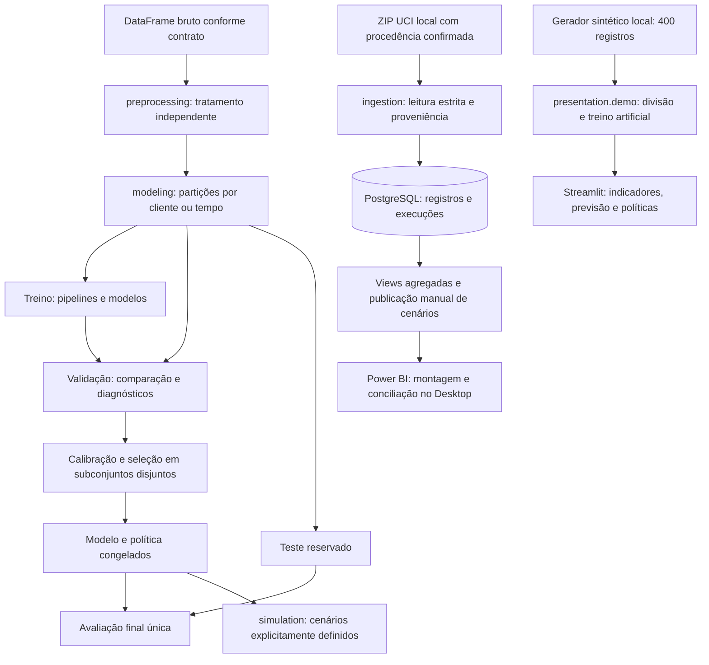

# Arquitetura da versão demonstrativa

Este documento consolida o fluxo descrito nas entregas existentes. O documento `arquitetura-e-desenvolvimento.md` permanece como registro histórico da estrutura inicial.

## Responsabilidades

| Camada | Responsabilidade | Fronteira |
| --- | --- | --- |
| ingestion | Validar ZIP/XLS e registrar procedência | Não baixa a fonte nem aplica migrações |
| preprocessing | Normalizar tipos e produzir relatório de qualidade | Não aprende imputações nem persiste automaticamente |
| persistence | Esquema, conexões e operações parametrizadas | Credenciais fornecidas pelo ambiente |
| analysis | Indicadores SQL e exploração local | Resultados agregados; exploração orientadora restrita ao treino |
| modeling | Separação, treinamento, comparação e avaliação | Transformações aprendidas somente no treino; teste reservado |
| simulation | Comparar limiares e hipóteses financeiras | Não otimiza automaticamente a política nem estima causalidade |
| presentation | Serviços demonstrativos e interface | Demonstração sintética independente do banco |

## Integrações que exigem ação explícita

A ingestão estrita e o tratamento independente possuem contratos diferentes. Categorias textuais e `pd.NA` produzidos pelo tratamento não devem ser encaminhados diretamente ao conversor inteiro da ingestão. Esta versão não acrescenta uma integração automática entre eles.

A calibração exige subdivisões de desenvolvimento planejadas, com clientes disjuntos e respeito à cronologia quando aplicável. Dividir posteriormente uma validação já usada na escolha de modelo não elimina seu possível otimismo.

A avaliação final recebe previsões e manifesto congelados. Seu bloqueio por diretório é local e não impede que outro diretório seja utilizado; a governança deve impedir avaliações repetidas usadas para novas escolhas.

O Power BI utiliza provisionamento SQL separado do Alembic, cenários publicados manualmente e relatório montado no Desktop. Não há PBIX/PBIT validado nem conexão automática entre a interface sintética e as tabelas do banco.

## Reprodução e rastreabilidade

Conservar versão do código, ambiente, hashes reais da fonte, ordem das partições, configuração do modelo e política. Sementes isoladas não garantem identidade entre plataformas. As dependências diretas estão fixadas; não há lock transitivo com hashes comprovado no material fornecido.

A demonstração pode ser exercitada sem rede e sem PostgreSQL após preparação das dependências. O fluxo completo exige fonte elegível, banco provisionado, migrações e evidências de execução. Nenhuma dessas operações foi executada para esta entrega documental.
